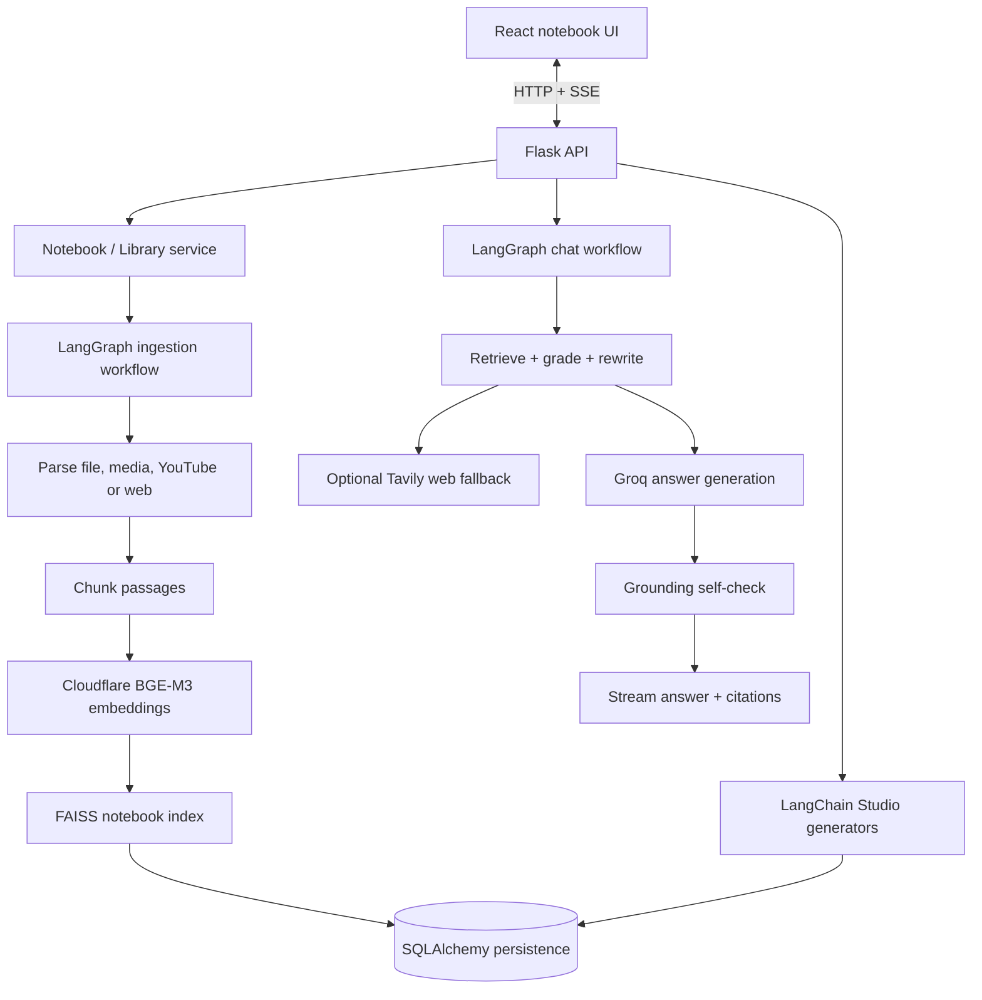

# RAG-Based AI Notebook

A notebook-style AI workspace for bringing documents, media, YouTube videos, and web pages into one place, then asking source-grounded questions and generating study materials. Each notebook has its own source library, conversation history, and saved outputs.

## Features

- **Notebook workspace:** Create, rename, list, and delete notebooks.
- **Multi-format ingestion:** Upload PDF, DOCX, PPTX, TXT, Markdown, audio, and video files, or add a webpage or YouTube URL.
- **Source processing:** Parse and chunk content, create embeddings, index passages, and show ingestion status.
- **Source guides:** Optionally create a short source summary, key topics, and starter questions.
- **Grounded chat:** Ask questions against all sources or a selected subset; retrieve passages and cite the supporting source and location.
- **Agentic retrieval:** Analyze the question, retrieve passages, grade relevance, rewrite queries when needed, and fall back to web search when enabled.
- **Answer verification:** Run a self-check against source context and retry a response once when unsupported content is detected.
- **Answer styles:** Select the configured response style for different explanation needs.
- **Study Studio:** Generate briefings, study guides, FAQs, timelines, mind maps, flashcards, quizzes, and suggested questions.
- **Streaming UI:** Chat and generation responses can stream through Server-Sent Events.
- **Persistent data:** Store notebooks, source metadata, passages, vectors, messages, and Studio outputs in SQLite or PostgreSQL.
- **Responsive interface:** React-based Sources, Chat, and Studio panels with light/dark theme.

## Supported source types

| Source | Ingestion path |
|---|---|
| PDF | Extract text and page locators |
| DOCX | Extract paragraphs, headings, and tables |
| PPTX | Extract slide text, tables, and notes |
| TXT / Markdown | Read text and preserve section context for Markdown |
| Audio | FFmpeg conversion and Groq Whisper transcription |
| Video | Extract audio with FFmpeg, then transcribe |
| YouTube | Try captions first; download audio and transcribe when captions are unavailable |
| Webpage | Fetch and extract readable page content |

Scanned/image-only PDFs are not OCR-processed by the current parser. Ingestion accepts HTTP(S) web links and applies URL validation/SSRF safeguards.

## Architecture



### Ingestion workflow

The ingestion graph selects a loader based on source type, extracts text or timestamped transcript segments, chunks the content while retaining page/slide/time locators, creates embeddings in batches, and adds the passages to the notebook's FAISS index. Ingestion work is dispatched through a bounded thread pool.

### Chat workflow

The chat graph classifies the request as a direct conversational response or a library question. Library requests are searched against FAISS, optionally graded for relevance, and rewritten up to the configured limit when retrieval is weak. If local sources remain insufficient and web fallback is configured, the system can search the web. The response is generated with source context and checked for grounding, with one regeneration opportunity before a warning is returned.

### Persistence and ownership

There is no account login in the current implementation. The browser generates a random device owner key and sends it through `X-Owner-Key`; the API stores its hash and associates notebooks with it. Notebook-specific requests also use `X-Notebook-Id`. Anyone who obtains the device key may be able to access its notebooks, so keep a backup private. Clearing browser storage without backing up the key can result in loss of access.

The database is the durable source of truth. Open notebooks and FAISS indexes are cached in memory and can be unloaded; saved chunks and embeddings are restored from the database when a notebook is reopened.

## Tech Stack

| Layer | Technologies |
|---|---|
| Frontend | React 19, Vite 8, Tailwind CSS 4, React Markdown, remark-gfm, rehype-highlight |
| Backend | Python 3.12, Flask, Gunicorn, Flask-CORS, Flask-Limiter |
| Agent orchestration | LangGraph (chat and ingestion graphs) |
| LLM / chains | LangChain Core, Groq (`openai/gpt-oss-120b`) |
| Embeddings | Cloudflare Workers AI BGE-M3 (`@cf/baai/bge-m3`) |
| Retrieval | FAISS vector index, cosine similarity |
| Persistence | SQLAlchemy, SQLite by default, PostgreSQL via psycopg |
| Web search | Tavily (optional fallback) |
| Media pipeline | FFmpeg / ffprobe, Groq Whisper (`whisper-large-v3`), yt-dlp, YouTube Transcript API |
| File parsing | pypdf, python-docx, python-pptx, trafilatura |
| Quality / analytics | pytest, Vitest, Testing Library, Oxlint, Vercel Analytics and Speed Insights |
| Deployment | Docker Compose, separate backend/frontend Dockerfiles, Nginx, Gunicorn |

## Repository structure

```text
RAG_Based_AI_Notebook/
├── backend/
│   ├── app/                   # Flask factory, API routes, chat and ingest graphs
│   ├── tests/                 # Backend tests
│   ├── requirements.txt
│   ├── .env.example
│   ├── Dockerfile
│   └── wsgi.py
├── frontend/
│   ├── src/
│   │   ├── components/
│   │   ├── hooks/
│   │   └── services/
│   ├── package.json
│   ├── Dockerfile
│   └── nginx.conf
├── docker-compose.yml
└── README.md
```

## Getting started

### Requirements

- Python 3.12
- Node.js 20.19+ (or a compatible newer version)
- FFmpeg and ffprobe available on the backend PATH for audio/video processing
- Groq API key
- Cloudflare account ID and Workers AI API token
- Optional Tavily API key for web-search fallback

### 1. Clone the repository

```bash
git clone https://github.com/srini526/RAG_Based_AI_Notebook.git
cd RAG_Based_AI_Notebook
```

### 2. Configure the backend

```bash
cd backend
python -m venv .venv
```

Activate the environment and install:

```bash
pip install -r requirements.txt
```

Create `.env` from the supplied example and fill in the required values:

```env
GROQ_API_KEY=your_groq_api_key
CLOUDFLARE_ACCOUNT_ID=your_cloudflare_account_id
CLOUDFLARE_API_TOKEN=your_cloudflare_workers_ai_token
ALLOWED_ORIGINS=http://localhost:5173
# Optional web fallback
TAVILY_API_KEY=your_tavily_api_key
```

See [backend/.env.example](backend/.env.example) for the full configuration surface, including model choices, notebook limits, rate limits, daily usage caps, retention, and YouTube options.

Start the backend:

```bash
python wsgi.py
```

The API listens on `http://localhost:8000` by default.

### 3. Start the frontend

In a second terminal:

```bash
cd frontend
npm install
npm run dev
```

Open `http://localhost:5173`.

### Docker Compose

From the repository root:

```bash
cp backend/.env.example backend/.env
# Edit backend/.env with provider credentials
docker compose up --build
```

Open `http://localhost:8080`. The compose file maps the backend to port 8000 and stores notebook data in a named Docker volume.

## API overview

The Flask API is rooted at `/api`. Notebook ownership is established with `X-Owner-Key`; notebook-scoped routes also use `X-Notebook-Id`.

| Endpoint | Purpose |
|---|---|
| `GET /api/health` | Health and provider configuration status |
| `GET /api/config` | Client configuration, limits, answer styles and generation kinds |
| `GET /api/notebooks` / `POST /api/notebooks` | List or create notebooks |
| `PATCH /api/notebooks/{id}` / `DELETE /api/notebooks/{id}` | Rename or delete a notebook |
| `GET /api/notebook` | Load notebook details, sources, messages, and outputs |
| `POST /api/library/file` / `POST /api/library/url` | Add a file or URL to the library |
| `GET /api/library` / `DELETE /api/library` | List or clear sources |
| `POST /api/chat` / `POST /api/chat/stream` | Ask a question synchronously or with SSE |
| `POST /api/generate` | Stream a Studio output |
| `DELETE /api/outputs/{id}` | Delete a saved output |

## Configuration and safeguards

Defaults are defined in `backend/app/config.py` and can be overridden through environment variables. The main defaults include:

| Setting | Default |
|---|---:|
| Notebooks per device owner | 10 |
| Sources per notebook | 10 |
| Maximum upload | 100 MB |
| Maximum audio/video duration | 120 minutes |
| Retrieved passages | 6 |
| Query rewrites | 2 |
| Loaded notebook cache | 30 notebooks |
| Idle cache unload | 60 minutes |
| Notebook retention | 60 days |
| Chat rate limit | 20 per minute |
| Ingestion rate limit | 20 per hour |
| Global daily chat / generate / ingest caps | 2,000 / 300 / 300 |

The backend also includes input limits, public-URL checks to reduce SSRF risk, DOCX/PPTX unpacked-size checks, rate limiting, daily usage budgets, non-root Docker user configuration, and security headers.

Run one Gunicorn worker for the current in-memory notebook cache design. Persistent notebook content lives in the database; the open-notebook cache and LangGraph checkpointer are process-local.

## Tests

Backend:

```bash
cd backend
pytest -q
```

Frontend:

```bash
cd frontend
npm test
npm run lint
npm run build
```

## Current limitations

- No account login: device-key possession controls notebook ownership.
- Scanned/image-only PDFs are not OCR processed.
- YouTube audio download may fail from some cloud IP ranges; caption retrieval is attempted first. Proxy and cookie options are configurable.
- Long Studio sources are sampled to fit the configured context budget, so small details may be omitted.
- Retrieval uses vector similarity; there is no BM25 hybrid retrieval or dedicated reranker in the current implementation.
- Audio Overview is not implemented.
- A single process holds active notebook caches and checkpointer memory; deployment must account for this architecture.

## Roadmap

See [plan.md](./plan.md) for planned improvements and implementation phases.

---

MIT licensed.
